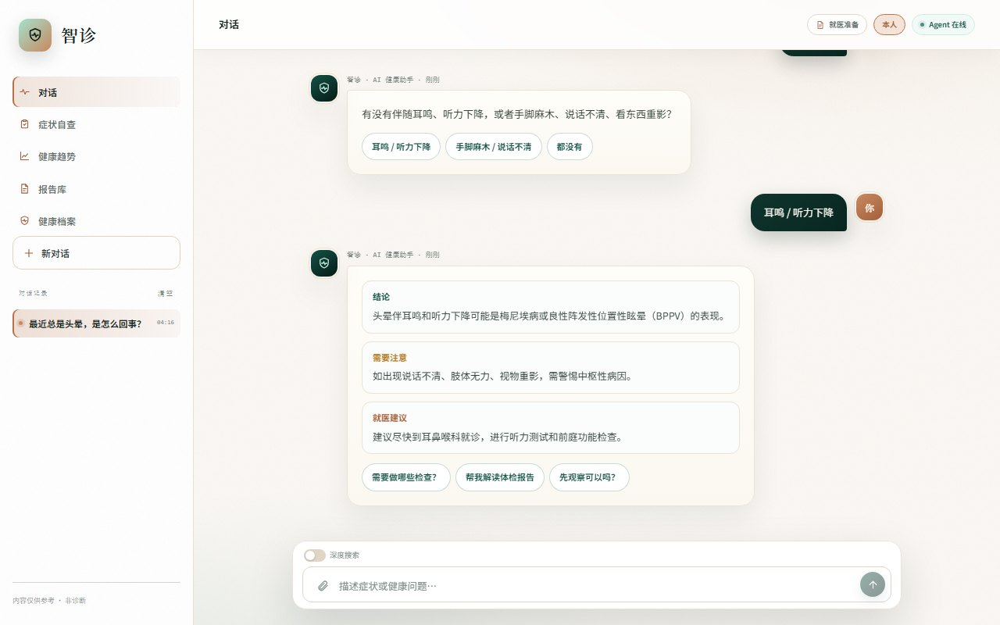
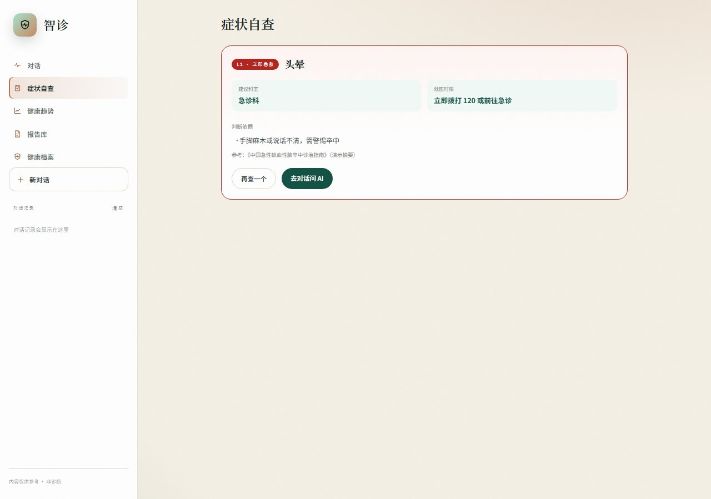
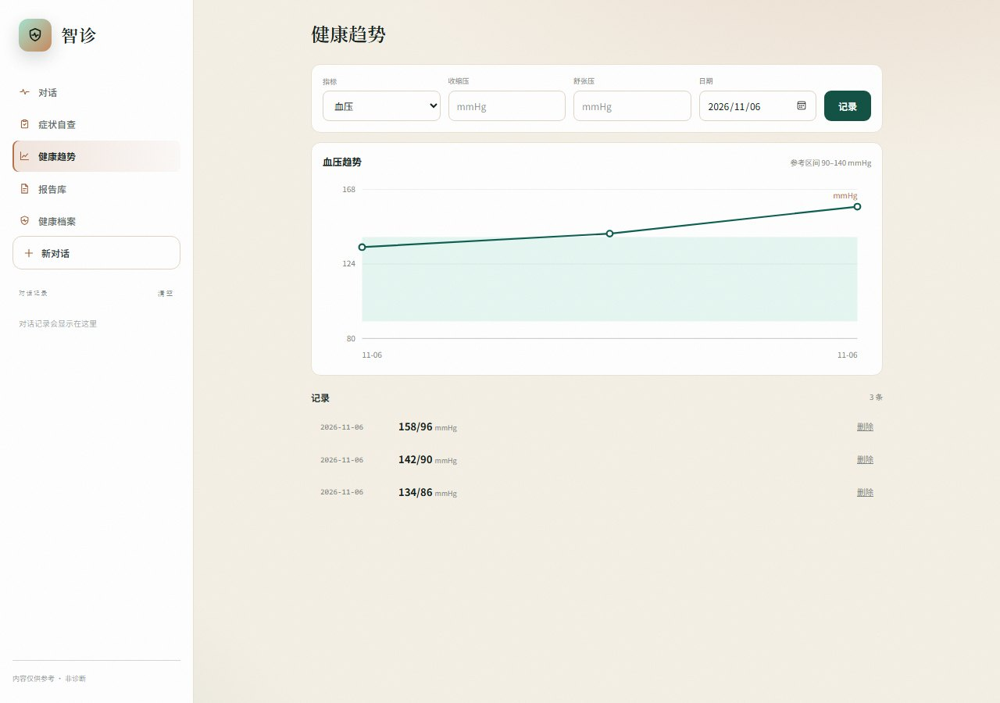
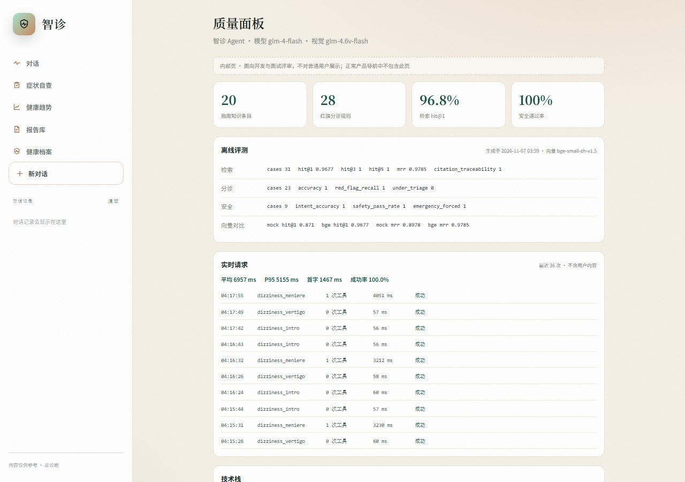
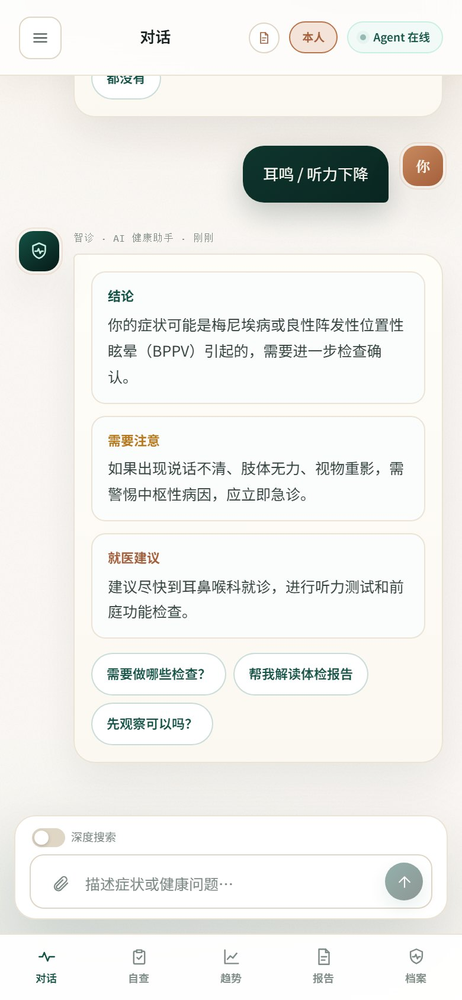
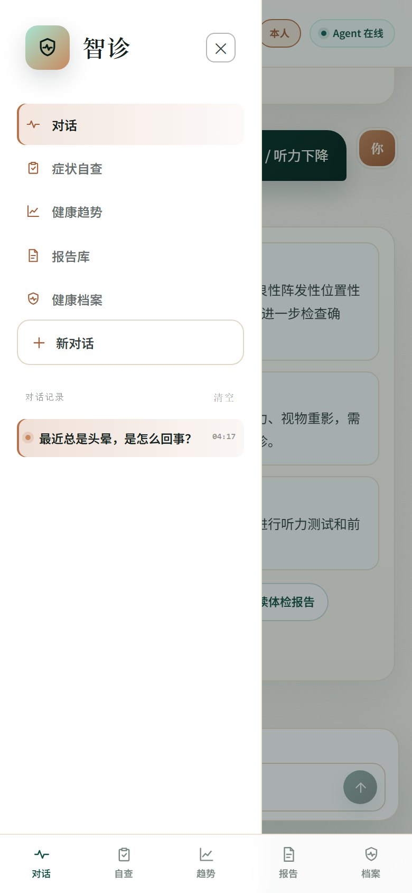
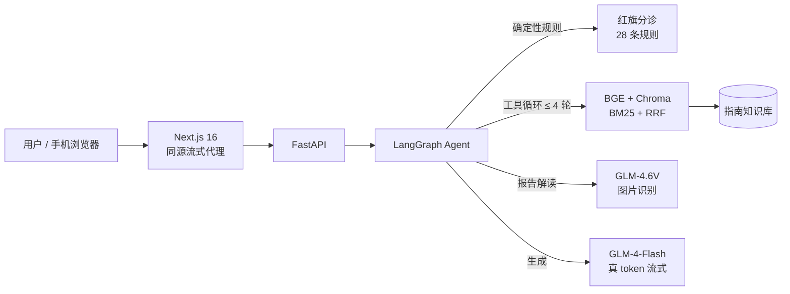

# 智诊 · AI 健康助手

[](https://github.com/RIOLI724/zhizhen-health-agent/actions/workflows/ci.yml)
[](LICENSE)

一个 **chat-first 的健康 Agent**：会追问、会查指南、会读报告、会自查分诊、会跟踪指标，红旗强制急救。

> A chat-first medical health agent built with Next.js, FastAPI and LangGraph — BGE semantic retrieval, streaming tool loop, and rule-enforced red-flag triage.

> 演示数据，不构成诊断；急危重症请立即拨打 120。

## 截图

### 对话



### 产品功能

| 症状自查 | 健康趋势 | 内部质量页 |
| --- | --- | --- |
|  |  |  |

> 质量页是内部工程页，不进入用户导航；用于面试评审查看评测与延迟数据。

### 手机端

| 对话 | 对话记录抽屉 |
| --- | --- |
|  |  |

## 现在能做什么

**对话**
- 指南问答：本地 BGE 语义检索 + BM25 + RRF 混合检索 → 模型按【结论】【需要注意】【就医建议】分块回答
- Agent 工具循环：模型自己决定调检索 / 深度检索 / 报告工具，最多 4 轮
- 真 token 流式：模型每产出一个 token 立即推给前端（首字延迟可观测）
- 会话记忆：同一对话记住已提症状；会话就诊人（本人 / 家人）自动注入

**健康能力**
- 报告上传（真实识别）：GLM-4.6V-Flash 视觉模型提取指标 → 报告卡 + 解读；图片仅内存处理
- 症状自查向导：5 类症状结构化问卷 → 风险等级 + 科室 + 时限 + 依据
- 健康趋势：血压 / 血糖 / 体重记录 + 趋势图（参考区间）
- 就医准备单：一键从对话生成可复制的就诊清单
- 报告库：上传与样例解读自动入库，可回看 / 删除
- 红旗急救：5 类症状 + 数值型（血糖/血压/血氧）+ 意识障碍 / 吞咽困难 / 独立出血，规则强制升级，模型无权降级

**产品**
- 健康档案：多就诊人，激活制，本机保存
- 手机端：底部导航（对话 / 自查 / 趋势 / 报告 / 档案）

## 技术栈

| 层 | 选型 |
| --- | --- |
| 前端 | Next.js 16（App Router）+ React 19 + TypeScript + Tailwind CSS 4 |
| 后端 | FastAPI + LangGraph 状态图 |
| 通信 | SSE，模型 token 级真流式（Next 路由同源透传） |
| 检索 | 本地 BGE 中文语义向量（fastembed）+ BM25 + RRF 混合检索 |
| 分诊 | JSON 规则引擎：28 条红旗规则，模型不可降级 |
| 模型 | 对话 glm-4-flash + 视觉 glm-4.6v-flash（均免费档）；不绑卡 0 成本，失败自动回退规则模板 |

## 架构



## 环境要求

- Python 3.12+
- Node.js 22+
- Windows / macOS / Linux 均可
- 首次启动会下载本地语义模型（约 90MB）；离线环境可设 `EMBEDDING_PROVIDER=mock` 回退

## 本地启动

### 1. 后端

Windows：

```bash
cd backend
python -m venv .venv
.venv\Scripts\activate
pip install -r requirements.txt
uvicorn app.main:app --host 127.0.0.1 --port 8000 --reload
```

macOS / Linux：

```bash
cd backend
python3 -m venv .venv
source .venv/bin/activate
pip install -r requirements.txt
uvicorn app.main:app --host 127.0.0.1 --port 8000 --reload
```

### 2. 前端

```bash
cd frontend
npm install
npm run dev
```

打开 <http://localhost:3000>。

> 开发脚本使用 `next dev --webpack`：当前 Windows 环境下 Turbopack 的 Tailwind CSS loader 会崩（`0xc0000142`），已切到 Webpack + `@tailwindcss/postcss`。

### 3. 配置真实模型（可选）

```bash
cd backend
copy .env.example .env     # Windows
cp .env.example .env       # macOS / Linux
```

在 `.env` 填入：

```ini
LLM_API_KEY=你的智谱 Key
EMBEDDING_API_KEY=你的智谱 Key
```

重启后端即可。没有 Key 时自动使用 Mock 模型与规则模板，demo 和测试不依赖外部服务。模型调用失败也会自动回退，不会中断对话。

## 在 IDE 里运行

项目自带两套 IDE 启动配置，克隆后无需手写命令：

| IDE | 怎么跑 |
| --- | --- |
| **VS Code**（免费，推荐） | 打开仓库根目录 → 装 Python 扩展 → 左侧"运行和调试" → 选 **「前后端一起启动」** → F5 |
| **IDEA 旗舰版 / PyCharm** | 打开仓库根目录 → 设置解释器为 `backend/.venv` → 右上角运行配置下拉框 → 选「后端 FastAPI」或「前端 Next.js」 |
| **IDEA 社区版** | 不支持 Python 后端；前端可跑，后端请改用 VS Code / PyCharm 或终端命令 |

配置文件位置：`.vscode/launch.json`、`.idea/runConfigurations/`（已随仓库共享）。

## 手机真机预览（同一 Wi-Fi）

1. 电脑执行 `ipconfig`，找到 IPv4（例如 `192.168.1.10`，以你的实际地址为准）
2. 在 `frontend/.env.local` 写入（把示例 IP 换成你的 IPv4）：
   ```ini
   DEV_ORIGINS=127.0.0.1,192.168.1.10
   ```
3. 重启前端后，手机连同一个 Wi-Fi，浏览器打开 `http://<你的 IPv4>:3000`
4. 首次访问 Windows 防火墙弹窗时，允许 Node.js 的专用网络访问

前端通过同源路由代理 `/api` 到后端，手机只需要访问 3000 端口。

## 试一下

- 上传一张报告照片（📎 按钮）→ AI 识别指标并分块解读
- 点「最近总是头晕」→「天旋地转」→「耳鸣 / 听力下降」：追问 + 检索 + 追问按钮
- 打开「症状自查」→ 头晕 → 天旋地转 + 手脚麻木：看 L1 风险卡
- 打开「健康趋势」→ 记录几条血压：看参考区间与趋势图
- 在「健康档案」把本人性别设为女、勾选孕产期，回对话输入「下腹痛出血」：看宫外孕红旗
- 打开「深度搜索」再提问：模型会多角度检索
- 输入「帮我看看 CT 片子」：看影像拒答

## 面试时值得讲的 4 个技术点

1. **安全边界不是提示词，是架构**：红旗分诊走确定性规则，模型无权降级；固定拒答（影像/安眠药）不经过模型。
2. **检索有评测闭环**：把哈希向量换成 BGE 语义模型后，同义改写评测集 hit@1 从 87.1% → 96.8%，MRR 0.90 → 0.98。
3. **真流式**：模型逐 token 经队列桥接到 SSE；发现并修复了 Next 开发代理缓冲导致"假流式"的问题。
4. **产品思维**：回答只留正文与结构化卡片；工程指标页不进入用户导航，只在 README/内部页给评审看。

## 安全审查

| 项 | 结论 |
| --- | --- |
| 依赖漏洞 | 前端 npm audit 0 漏洞；后端 pip-audit 仅 chromadb 5 条 CVE，均针对其**服务端 HTTP API**（恶意模型仓库 / 多租户越权）。本项目使用嵌入式 `PersistentClient`，不启动 chroma server、不暴露 8001 端口，不可利用；CI 中带说明豁免 |
| 密钥 | 仅后端 `.env` 持有，已 gitignore；前端无任何密钥；全历史扫描无 Key |
| XSS | React 全程转义，无 `dangerouslySetInnerHTML`；上传仅接受 JPG/PNG/WebP，不接受 SVG |
| 注入面 | 无 SQL / shell / eval；上传图片 base64 内存处理，不落盘 |
| 合规边界 | 本地单用户演示：无账号体系与限流，禁止直接暴露公网；如需公网需补认证、限流、合规审核 |
| 输出安全 | 正则护栏 + 流式越界替换机制；提示词注入用例纳入评测集 |

## 测试与评测

```bash
cd backend
.venv\Scripts\python -m pytest
.venv\Scripts\python -m eval.run_eval --check
.venv\Scripts\python -m ruff check app eval tests run.py

cd frontend
npx tsc --noEmit
npm run lint
```

当前：

- 后端 76 个测试通过
- 检索评测 31 条：BGE 语义向量 hit@1 96.8%、hit@3 100%、MRR 0.98；对比哈希向量 hit@1 87.1%、MRR 0.90
- 分诊评测 23 条：准确率 100%，红旗召回 100%，低判 0
- 安全评测 9 条（含提示词注入 / 越权开药）：意图准确率 100%，越界拒答 100%，急救强制 100%
- 前端类型检查、lint、六个页面生产构建通过
- GitHub Actions 自动跑 ruff + 后端测试 + 评测门禁 + 前端构建

## 当前边界（2.0）

- 本地 BGE 模型首次运行需下载约 90MB；离线环境可设 `EMBEDDING_PROVIDER=mock` 回退
- 上传识别基于免费视觉模型，手写/翻拍质量差的报告可能识别不准，界面会明确提示
- 深度搜索是模型多轮工具调用（上限 4 轮），不是无限迭代 agent
- 回答不显示来源列表（产品决策）；检索仍在后端为生成提供依据
- 不做诊断、处方、影像解读；报告图片仅内存处理，不落盘不回传
- 本地单用户演示：无账号体系，数据存浏览器本机

## 下一步

- 已完成：GitHub 发布（CI 全绿）
- Docker 化 + 部署说明
- 公网化加固：认证、限流、合规审核

## 免责声明

本项目为演示作品，不构成医疗建议，不替代医生面诊。急危重症请立即拨打 120。
